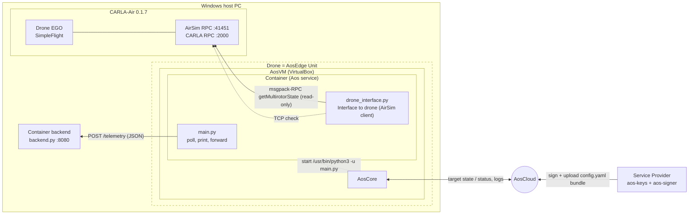

# AOS-Drones-PoC — MVP Implementation Plan

**Prepared:** 26-Sep-2026 · Author: Andrii Burachynskyi (EPAM), with Claude
**Based on:** `C:\DOCs\PreSales\aos-2026-Sept\AOS-Drones-PoC-Concept.md`, section 2 (AOS-Drones-PoC diagram)
**Code:** `C:\workspace\carla-air\aos-drones-poc\` (`container/`, `container_backend/`)

---

## 1. Goal of the MVP

The MVP is the smallest end-to-end implementation of the AOS-Drones-PoC diagram:

1. The **Container** is a Python application built by the Service Provider. It reads the coordinates of the simulated **Drone EGO** from the local **CARLA-Air 0.1.7** (CARLA port 2000, AirSim port 41451).
2. It **prints** the coordinates to the console.
3. It sends them to the **Container backend**.

The same Container code runs:

- **natively on Windows** (stage A: local check); and
- as an **Aos service inside the AosVM**, deployed via AosCloud (stage B: the actual PoC message).

Out of scope for the MVP: flight commands (take-off, waypoints, landing), missions from the backend, a separate *drone-bridge* service, and persistence in the backend. These are the next increments; see section 8.

---

## 2. Answers to the investigation questions

### Q1. What should be used as the ServiceProvider? Do we need to build and start a component for it?

**No component needs to be built or run.** In AosEdge, the ServiceProvider (SP) is a **role/organisation in AosCloud** plus a user certificate and the `aos-signer` CLI:

| What | Where / how |
|---|---|
| SP account | Created at AosCloud sign-up (aosedge.tech). The SP token arrives by e-mail. |
| SP user certificate | `aos-keys new-user -d aoscloud.io -t <SP token> --sp` creates `%USERPROFILE%\.aos\security\aos-user-sp.p12` |
| Packaging tool | `aos-signer` 2.0.2, already installed in `C:\workspace\carla-air\aos\venv` (see `README-AOS.md`) |
| SP deliverable | `container/config.yaml` plus `container/drone-telemetry/src_any/*` |
| SP action | `container/scripts/sign-and-upload.ps1` runs `aos-signer sign` and `aos-signer upload`. AosCloud creates the service on the first upload. |
| Deploy | **OEM** portal (oem.aoscloud.io) → **Subjects → +** → add the service → assign the drone Unit. Subjects are an OEM permission, and the OEM account cannot create services, so publishing always takes both accounts. See `container/PUBLISH.md`. |

The diagram's "ServiceProvider → Container" arrow ("Deploy the container") is carried out physically as **SP → AosCloud → AosCore → Container**, as the concept (C3) already notes.

### Q2. What will be used as the "Container backend"? Do we need to build and start a component for it?

**Yes, we generate and start it.**

- AosCloud provides no backend for services. Its functions are orchestration and monitoring. The SP always hosts its own backend; the official AOS hello-world simply posts to webhook.site.
- For the PoC we built `container_backend/backend.py`, a standard-library HTTP server that runs on the **Windows host** (port 8080). It:
  - receives telemetry (`POST /telemetry`);
  - validates and prints it;
  - keeps the latest record per drone (`GET /telemetry/latest`).
- It is started with `container_backend/scripts/run-backend.ps1`.
- The Container in the AosVM reaches it the same way it reaches CARLA-Air: through the VirtualBox gateway to the host.

### Design decisions agreed

| Decision | Choice | Reason |
|---|---|---|
| How the Container gets coordinates | **It polls AirSim RPC** (`getMultirotorState`) | CARLA-Air only offers request/response RPC servers (AirSim msgpack-RPC on 41451, CARLA RPC on 2000). It cannot push webhooks. |
| Backend | **Local Python backend** on the host | Under our control and offline. It shows link C5 end to end. |
| Project layout | **Two separate Python projects** in `aos-drones-poc/` | They have different deployment paths (AOS vs. host), different runtime limits (the Container is stdlib-only) and independent life cycles. They share only the JSON contract. |

---

## 3. Architecture of the MVP



How this maps onto the concept diagram:

| Concept element | MVP realisation |
|---|---|
| Carla Air / Drone EGO | CARLA-Air 0.1.7, vehicle `SimpleFlight` |
| VM | AosVM (`aos-prov unit-new`) |
| AosCore | Standard AosCore in the AosVM |
| Container | `container/` → Aos service `aos-drones-poc-container` |
| Interface to drone | `drone_interface.py` inside the Container (concept option B). It is kept behind a narrow API (`get_drone_state()`) so it can later be split into a separate *drone-bridge* service (option A). |
| AosCloud | aoscloud.io (SaaS) |
| ServiceProvider | SP account + `aos-signer` (no component) |
| Container backend | `container_backend/backend.py` on the host |

---

## 4. Key technical constraints and how they are handled

| # | Constraint | Handling |
|---|---|---|
| T1 | Aos Python services are **not Docker images**. The source folder is packaged and run with the unit's `/usr/bin/python3` (as in hello-world). Only the standard library is guaranteed. | The Container uses only the stdlib. It includes a small msgpack codec (`msgpack_lite.py`) and its own AirSim msgpack-RPC client, in place of the PyPI `airsim` + `msgpack-rpc-python`/tornado packages. |
| T2 | An AirSim client that takes API control can take over the CARLA-Air drone. | Read-only calls only: `ping`, `getMultirotorState`. There is no `enableApiControl`. |
| T3 | The CARLA Python client is a Windows cp310 wheel (`PythonAPI\carla\dist\carla-0.9.16-cp310-cp310-win_amd64.whl`), unusable in the Linux AosVM. | CARLA :2000 gets a TCP reachability check at startup only. Coordinates come from AirSim. |
| T4 | The `config.yaml` format | `schemaVersion: 2`, following `github.com/aosedge/hello-world`: items / identity / sourceFolder / images (`src_any`, arch `any`) / configuration (cmd, workingDir, instances, quotas). |
| T5 | The AosVM must reach the host (AirSim 41451, backend 8080). | Host IP goes in the `cmd` args of `config.yaml` (default `10.0.2.2`, the VirtualBox NAT host). `check-network.ps1` verifies the listen addresses and adds firewall rules. |

---

## 5. Implementation (status)

| # | Step | Deliverable | Status |
|---|---|---|---|
| 1 | Minimal msgpack codec + tests | `container/drone-telemetry/src_any/msgpack_lite.py`, `tests/test_msgpack_lite.py` | ✅ done, tests pass |
| 2 | Interface to drone: AirSim RPC client, `DroneState`, CARLA TCP check | `drone_interface.py` | ✅ done |
| 3 | Settings (defaults < env < CLI), backend client, main loop with reconnect/backoff, `print(flush=True)` | `settings.py`, `backend_client.py`, `main.py` | ✅ done |
| 4 | Container backend | `container_backend/backend.py`, `tests/test_backend.py` | ✅ done, tests pass |
| 5 | Aos bundle config | `container/config.yaml` | ✅ done; host IP to be confirmed on the Unit |
| 6 | Scripts | `container/scripts/{run-local,sign-and-upload,check-network}.ps1`, `container_backend/scripts/run-backend.ps1` | ✅ done |
| 7 | Documentation | `README.md`, `container/README.md`, `container_backend/README.md`, this plan | ✅ done |
| 8 | Stage A: local run against real CARLA-Air | Console and backend output | ✅ verified 26-Sep-2026 (see 6.2) |
| 9 | Stage B: deploy through AosCloud to AosVM | Service active on the Unit, logs in AosCloud | ⏳ pending: needs the Unit (`aos-prov unit-new`) and the SP certificate |

---

## 6. Verification

### 6.1 Offline tests (no CARLA-Air)

```powershell
cd C:\workspace\carla-air\aos-drones-poc\container;         python -m unittest discover tests -v   # 7 tests
cd C:\workspace\carla-air\aos-drones-poc\container_backend; python -m unittest discover tests -v   # 3 tests
```

The Container tests use a **fake AirSim RPC server** and a **fake backend**:

- codec round-trips;
- `ping` / `getMultirotorState`;
- a full `main.py` run that prints 3 lines and delivers 3 records matching the contract.

### 6.2 Stage A: local, against real CARLA-Air (verified)

1. Start CARLA-Air (`StartCarlaAir.bat`).
2. Run `container_backend\scripts\run-backend.ps1`, then `container\scripts\run-local.ps1`.
3. Observed result:
   ```
   [container] CARLA RPC 127.0.0.1:2000 reachable: yes
   [container] connected to AirSim at 127.0.0.1:41451
   [drone SimpleFlight] t=1790419432397845248 NED x=-0.05 y=0.05 z=29.24 m | GPS lat=47.639921 lon=-122.137713 alt=120.4 m | landed=Landed
   [backend] drone-local-01 from 127.0.0.1: NED x=-0.05 y=0.05 z=29.24 m | GPS lat=47.639921 lon=-122.137713 alt=120.4 m | Landed
   ```
4. `check-network.ps1` shows that CARLA-Air listens on **0.0.0.0** for both 41451 and 2000, so it is reachable from the VM once the firewall allows it.
5. To do in the demo: fly the drone (`examples\fly_drone_keyboard.py`) and watch the coordinates change.

### 6.3 Stage B: AOS deployment (next)

| Step | Action | Evidence (concept section 5.2) |
|---|---|---|
| B1 | Create the Unit: Portal target system `aos-vm`, `aos-prov download`, `aos-prov unit-new --name DroneUnit`, create a Unit-set | Unit online in AosCloud (**S1**) |
| B2 | In the VM: `ssh -p 8143 root@localhost`, `ip route` → host IP; check that `/usr/bin/python3` exists | Host IP known (default `10.0.2.2`) |
| B3 | Test from the VM: `python3 -c "import socket; socket.create_connection(('10.0.2.2',41451),3)"` and the same for 8080 | Ports reachable |
| B4 | On the host: `check-network.ps1 -AddFirewallRules` (Admin); backend running | — |
| B5 | Put the host IP in `config.yaml` `cmd` if needed, then run `sign-and-upload.ps1` | Service in AosCloud |
| B6 | OEM portal: **Subjects → +** → service `aos-drones-poc-container` → assign the Unit | Deployed only through AosCloud (**S2**) |
| B7 | Request the service log in AosCloud | `[drone SimpleFlight] ...` lines (**S6**) |
| B8 | Watch the backend console on the host | Telemetry arrives from the VM address (**S4**) |
| B9 | Bump `version` to 0.1.1 (e.g. change the poll interval), upload, then roll back | Update/rollback through AosCloud (**S5**) |

---

## 7. Risks

| # | Risk | Mitigation |
|---|---|---|
| R1 | The AosVM network (VirtualBox NAT or NAT network) does not route to the host IP, or the service namespace adds another NAT | Check `ip route` on node0. Try `10.0.2.2`, then the NAT-network gateway `.1`, then a host-only adapter. As a last resort, use a VirtualBox port-forward. |
| R2 | The Windows firewall blocks 41451 or 8080 from the VM | `check-network.ps1 -AddFirewallRules` |
| R3 | `/usr/bin/python3` is missing, or too old, on the AosVM image | Check in B2. The code needs Python 3.7+ (dataclasses). The fallback is a Python layer (docs: "share libraries") or pointing `cmd` at another path. |
| R4 | Quotas are too tight (`ramLimit 128MiB`) | Raise them in `config.yaml`. The service uses about 20 MB RSS. |
| R5 | CARLA-Air licence: academic and non-commercial use only | Clarify this before any client-facing demo (concept R1). |
| R6 | Host resources (GPU simulator + AosVM) | Concept R2: lower CARLA-Air quality; give AosVM 8 GB. |

---

## 8. Next increments (after the MVP)

1. **Flight control:** add a take-off / waypoint / land mission in the Container (AirSim `enableApiControl`, `armDisarm`, `takeoffAsync`, `moveToPositionAsync`, `landAsync`). The same msgpack-RPC client can be extended.
2. **Missions from the backend:** add `GET /mission` or a push channel from the Container backend to the Container (concept flow 4.3).
3. **Split Interface to drone into its own Aos service** (*drone-bridge*, concept option A), connected through `allowedConnections`. This shows independent life cycles.
4. **Backend:** persistence, a map dashboard, HTTPS and authentication, hosting in the SP cloud.
5. **Real autopilot:** replace the AirSim bridge with MAVLink / PX4 SITL, without changing the Container's mission logic.
